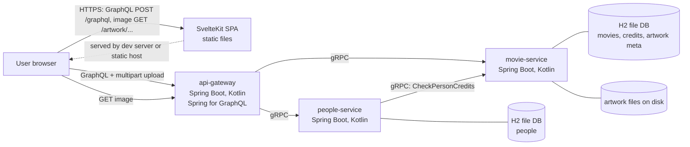
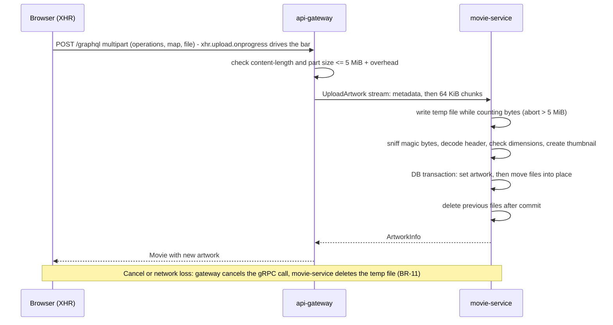

# Architecture — Movie Catalog

Status: **APPROVED 2026-10-21 (D10–D13)** · Version 0.1 · 2026-10-21
Inputs: approved `BRD.md`, `NFR.md`, `decisions-log.md` (D1–D9)
Companions: `data-model.md`, `docs/adr/`, contracts in `contracts/src/main/proto/` and `api-gateway/src/main/resources/graphql/schema.graphqls`

## 1. Approval items raised by this design

These go beyond the approved BRD and need your decision (see section 12).

| ID | Item | Why |
|----|------|-----|
| CR-01 | Amend NFR-ARCH-03: *all data operations* go through GraphQL, but image bytes are delivered by cacheable `GET` endpoints on the gateway | A browser `` cannot call GraphQL; base64 images inside GraphQL would defeat caching and thumbnails (ADR-007) |
| CR-02 | Person existence for `addCredit` is checked by the gateway, not by `movie-service` | Avoids a circular gRPC dependency movie ⇄ people (ADR-003) |
| CR-03 | Build location: Maven Central and the Gradle plugin portal are blocked in this cloud sandbox (HTTP 403 on CONNECT), so Kotlin services cannot be compiled or tested here | Affects Phases 7–10; see section 11 |

## 2. System context



Three Spring Boot services satisfy A-T3 (at least two). Service-to-service traffic is gRPC only (A-T4): gateway → movie, gateway → people, and people → movie. The browser talks only to the gateway (A-T5 as amended by CR-01).

## 3. Service responsibilities and boundaries

| Service | Owns | Does not do | gRPC port / HTTP port |
|---------|------|-------------|----------------------|
| `api-gateway` | GraphQL schema and resolvers; multipart upload parsing; artwork `GET` endpoints; orchestration across services (name resolution, person pre-check for credits, grouped search); error translation; CORS; query limits | Business rules, persistence | none / 8080 |
| `movie-service` | Movies, genres, credits, artwork (validation, storage, thumbnails); movie and credit search; credit check for deletion | Person data | 9091 / 8081 (actuator) |
| `people-service` | People; person search; batch lookup; delete rule BR-05 (asks movie-service) | Movies, credits, artwork | 9092 / 8082 (actuator) |
| `contracts` (Gradle module) | `.proto` files and generated Kotlin/Java stubs, shared by all services | Logic | n/a |

Dependency direction: `api-gateway → {movie-service, people-service}`, `people-service → movie-service`. There is no cycle. Business validation is authoritative in the owning service; the gateway checks only GraphQL shape (types, nullability, enums, upload limits).

## 4. Key flows

### 4.1 List movies (UJ-01)

Browser `movies(filter, sort, page)` → gateway → `MovieService.ListMovies` → returns movies with artwork info. The gateway builds image URLs `/artwork/{movieId}/thumbnail?v={version}`. Credits are not fetched for lists.

### 4.2 Movie detail with credits (FR-MOV-02, FR-CRD-04)

```mermaid
sequenceDiagram
  participant B as Browser
  participant G as api-gateway
  participant M as movie-service
  participant P as people-service
  B->>G: query movie(id) { ... credits { person { name } } }
  G->>M: GetMovie(id)
  G->>M: ListCreditsByMovie(id, limit 200)
  M-->>G: movie, credits (person ids)
  G->>P: BatchGetPeople(distinct person ids)  (one call, NFR-PERF-04)
  P-->>G: people found
  G-->>B: movie with credits; missing person = null (BR-07)
  Note over G,P: If people-service is down: credits returned with person null and a partial-error entry (EC-15)
```

### 4.3 Upload artwork with progress (UJ-02, FR-ART-01..04)



Progress shown by the browser reflects bytes sent to the gateway. Server-side processing after 100% is shown as a "Processing…" state so the bar never claims completion early.

### 4.4 Delete person (UJ-07, BR-05)

Browser `deletePerson(id)` → gateway → `PeopleService.DeletePerson` → people-service calls `MovieService.CheckPersonCredits`. If `credit_count > 0`, people-service fails with `FAILED_PRECONDITION` and `ErrorDetail(code=person.has_credits, blocking_movies)`. If movie-service is unreachable, the call fails with `UNAVAILABLE` and nothing is deleted (fail closed, EC-16). Gateway maps these to GraphQL `CONFLICT` (with `blockingMovies`) and `UNAVAILABLE`.

### 4.5 Add credit (FR-CRD-01)

Gateway calls `PeopleService.GetPerson` first (`NOT_FOUND` becomes `VALIDATION_FAILED` with `fieldErrors[{field: "personId", messageKey: "credit.person.not_found"}]`), then `MovieService.AddCredit`. Trade-off in ADR-003.

### 4.6 Search (UJ-06)

Gateway calls `SearchMovies` and `SearchPeople` in parallel with the same query and independent page requests, and returns both groups. If one side fails, the whole query fails with a clear error (simple and predictable; revisit if needed).

### 4.7 Delete movie

`MovieService.DeleteMovie` removes credits (DB cascade) and artwork rows in one transaction, then deletes files. File deletion failure is logged and does not fail the request; leftover files are listed by a startup orphan check (log only).

## 5. Frontend design (SvelteKit, TypeScript strict)

SPA mode (`ssr = false`, `adapter-static` with fallback page); see ADR-010.

### 5.1 Routes

| Route | Purpose | Requirements |
|-------|---------|--------------|
| `/` | Redirect to `/movies` | |
| `/movies` | Movie list: skeletons, thumbnails, sort, genre/year filters, pagination (query params keep state in the URL) | FR-MOV-01, FR-MOV-06 |
| `/movies/new` | Create form, with optional artwork picker | FR-MOV-03, FR-ART-01 |
| `/movies/[id]` | Detail: fields, artwork (replace/remove with progress), credits grouped by role with add/edit/remove, delete with confirmation | FR-MOV-02, FR-MOV-05, FR-ART-*, FR-CRD-* |
| `/movies/[id]/edit` | Edit form | FR-MOV-04 |
| `/people` | People list, sort, pagination | FR-PPL-01 |
| `/people/new`, `/people/[id]/edit` | Person forms | FR-PPL-02, FR-PPL-03 |
| `/people/[id]` | Person detail with filmography, delete with blocked-by-credits explanation | FR-PPL-04, FR-PPL-05 |
| `/search?q=` | Grouped results with debounce, loading, empty, error, too-short and "show more" | FR-SRC-* |

A header search box is on every page and navigates to `/search?q=`.

### 5.2 Structure

```
frontend/src/
  lib/api/          graphql client (fetch wrapper, AbortController), upload (XHR), typed operations, error mapping
  lib/components/   Button, TextField, TextArea, Select, Dialog, Toast, Skeleton, Pagination, ProgressBar,
                    MovieCard, PersonCard, ArtworkUploader, CreditEditor, SearchBox
  lib/stores/       toast store, search state (debounce + stale-response guard)
  lib/validation/   client mirrors of BRD section 7 rules (UX only; server is authoritative)
  routes/           pages above
  tests/            Vitest unit/component tests; e2e/ for Playwright
```

State handling rules: every async action has `idle | pending | success | error` state; lists show skeletons; mutations disable controls and show a toast; forms keep input on failure (AC-FR-EXT-02-1); stale search responses are cancelled with `AbortController` and a request counter.

Styling: hand-written CSS with custom properties; mobile-first breakpoints at 600 px and 960 px; no UI framework (ADR-010).

## 6. Error handling conventions (NFR-REL-01)

Every gRPC failure is a `google.rpc.Status` whose details include `common.v1.ErrorDetail` (`code`, `violations`, `blocking_movies`).

| gRPC status | Typical cause | GraphQL `extensions.code` | HTTP status of the GraphQL response |
|-------------|---------------|---------------------------|-------------------------------------|
| `INVALID_ARGUMENT` | Validation failure | `VALIDATION_FAILED` + `fieldErrors[{field, messageKey}]` | 200 (GraphQL convention) |
| `NOT_FOUND` | Unknown id | `NOT_FOUND` | 200 |
| `ALREADY_EXISTS` | `movie.duplicate`, `credit.duplicate` | `CONFLICT` | 200 |
| `FAILED_PRECONDITION` | `person.has_credits` | `CONFLICT` + `blockingMovies` | 200 |
| `UNAVAILABLE`, `DEADLINE_EXCEEDED` | Downstream down or slow | `UNAVAILABLE` | 200 |
| `CANCELLED` | Client aborted | not reported | n/a |
| anything else | Bug | `INTERNAL` with generic message | 200 |

Malformed identifiers fail with `VALIDATION_FAILED` and key `id.invalid` (gRPC `INVALID_ARGUMENT`). Every error carries `extensions.correlationId`. Messages never include stack traces, SQL or internal ids (NFR-UX-06). Upload size violations at the HTTP layer return the same GraphQL error shape with `VALIDATION_FAILED` and `artwork.too_large`. The frontend maps `messageKey` to user-facing text in one place.

Deadlines: gateway → services 3 s (list/get/search/mutations), 30 s for upload; people → movie 2 s. All configurable.

## 7. Security design (NFR-SEC-*)

| Area | Design |
|------|--------|
| Authentication / authorization | None in MVP (D2, NFR-SEC-10). All operations are open to anyone who can reach the gateway. Gateway is the only public entry; backend gRPC ports bind to localhost by default |
| Input validation | Shape at gateway (GraphQL types, enums, max request size); full rules in owning service (authoritative); frontend mirrors for UX |
| File upload | Size cap enforced at gateway request level and again while streaming in movie-service; type by magic bytes then successful decode (BR-08); dimension cap 6000×6000 to prevent decompression bombs; server-generated UUID file names, never the client name; files in a configured directory outside any static root; downloads sent with the detected `Content-Type`, `X-Content-Type-Options: nosniff`, and `Content-Disposition: inline`; SVG and GIF rejected |
| Injection | JPA/JDBC parameter binding only; `LIKE` patterns escaped with an explicit `ESCAPE` clause; user text rendered via Svelte text interpolation, never `{@html}` (lint rule) |
| GraphQL abuse | Max query depth and complexity configured; introspection enabled only in `dev` profile; request body size limit |
| CORS / headers | Allowed origin is the configured frontend origin; security headers (`nosniff`, `frame-options`, referrer policy) on gateway responses |
| gRPC | Deadlines, max message size (64 KiB chunks, 1 MiB max message), no internal details in status messages. Plaintext in local setup; TLS required for any shared deployment (ADR-004, NFR-SEC-08) |
| Secrets | None required. Configuration via `application.yml` plus environment variables; secret scanning in the quality gate |
| Data protection | Data is non-sensitive demo content. Logs exclude file content and request bodies. Rate limiting is **not** implemented (limitation, to disclose) |

## 8. Cross-cutting design

- **Correlation ID:** gateway generates or accepts `X-Correlation-Id`, puts it in the logging MDC and gRPC metadata; services copy it into their MDC (NFR-OBS-02).
- **Health:** each service exposes Spring Actuator `health`; gateway aggregates downstream gRPC health via the standard `grpc.health.v1` service (NFR-OBS-01).
- **Pagination:** all list calls take `PageRequest` (0-based) and return `PageInfo`; sorting by an allow-listed field only.
- **IDs:** UUID v4 strings generated by the owning service.
- **Time:** UTC `Instant` stored; serialised ISO-8601.

## 9. Technology and dependencies (justified, versions pinned in Phase 7)

Versions are intentionally **not pinned here**: the build repositories are unreachable from this sandbox, so versions cannot be verified yet (CR-03). Pinned versions will be recorded in `docs/adr/ADR-013`.

| Concern | Choice | Why needed |
|---------|--------|-----------|
| Language/runtime | Kotlin, JDK 21 (installed), Gradle (Kotlin DSL) multi-module | A-T2 |
| Web/DI | Spring Boot (current stable 3.x/4.x to verify) | A-T2 |
| GraphQL | Spring for GraphQL | A-T5, native Spring Boot integration |
| gRPC | Spring gRPC (preferred) or grpc-java + grpc-kotlin stub with manual server beans | A-T4; decision pending verification of Spring Boot compatibility (ADR-004) |
| Protobuf | protobuf Gradle plugin, `protoc` via artifact | Contract compilation |
| Persistence | Spring Data JPA, H2 file mode, Liquibase | D5 |
| Image processing | JDK `ImageIO` plus TwelveMonkeys `imageio-webp` | Decode/validate WebP and create thumbnails; the JDK cannot read WebP (ADR-012) |
| Backend tests | JUnit 5, MockK, Spring Boot Test, `grpc-testing` in-process channels, Spring GraphQL test tester, Kover | NFR-TEST-* |
| Static analysis | ktlint, detekt | NFR-MNT-01 |
| Frontend | SvelteKit and Svelte (npm currently lists `@sveltejs/kit` 3.1.0 and `svelte` 5.57.2 as latest; exact versions and any migration notes are confirmed and pinned in Phase 7), TypeScript strict, Vite | A-T1 |
| Frontend tests | Vitest, Testing Library for Svelte, Playwright, axe-core | NFR-TEST-*, NFR-A11Y-01 |
| Frontend lint | ESLint, Prettier, svelte-check | NFR-MNT-01 |
| Not used | UI framework, GraphQL client library, state library, ORM beyond JPA, API gateway products, message brokers | Avoid unnecessary dependencies (NFR-MNT-03) |

## 10. Configuration, run and deployment

| Setting | Default | Notes |
|---------|---------|-------|
| `GATEWAY_PORT` | 8080 | |
| `MOVIE_SERVICE_GRPC_PORT` | 9091 | bound to 127.0.0.1 |
| `PEOPLE_SERVICE_GRPC_PORT` | 9092 | bound to 127.0.0.1 |
| `MOVIE_DB_PATH` | `./data/movie-db` | H2 file |
| `PEOPLE_DB_PATH` | `./data/people-db` | H2 file |
| `ARTWORK_DIR` | `./data/artwork` | outside any static root |
| `FRONTEND_ORIGIN` | `http://localhost:5173` | CORS |
| `SPRING_PROFILES_ACTIVE` | `dev` | `dev` enables GraphQL introspection |
| `CATALOG_PEOPLE_DELETE_ENABLED` | `false` until story S-405 | Guards person deletion until the credit check exists |

Local run (target, verified in Phase 10; created in story S-004): `./scripts/dev.sh` starts the three services (Gradle `bootRun`) and the Vite dev server; `pnpm seed` (`scripts/seed/seed.mjs`, Node 22, no extra dependencies) loads demo data through the gateway's GraphQL API, so seeding exercises the real path and is idempotent (movies by title+year, people by exact name, artwork only when absent). Build for release: `./gradlew build` and `pnpm build` (static files). Docker is optional and will be provided only if it can be verified (NFR-OPS-04). H2 file databases mean single-instance deployment only.

## 11. Constraints found while designing

- **Build repositories blocked (CR-03).** From this cloud sandbox, `repo.maven.apache.org`, `plugins.gradle.org`, `services.gradle.org` and other Maven mirrors return 403 on CONNECT; npm and PyPI work. Proto and GraphQL contracts were validated here (protoc compile via Python `grpcio-tools`; `graphql` package schema build). Kotlin compilation and JVM tests cannot be run here. Options: (1) you link a local folder and I run builds on your computer through the desktop bridge (subject to its network policy); (2) I write code here and you run the builds and paste results, which I will treat as the only evidence; (3) request an egress allowlist change for Maven Central and the Gradle plugin portal. I will not claim any backend result without evidence.
- Docker daemon is not available here, so no compose validation (NFR-OPS-04).

## 12. Design validation against the assessment

| Assessment item | Design element | Status |
|-----------------|----------------|--------|
| A-F1 list movies with artwork | `movies` query, thumbnail endpoint, `/movies` | Covered |
| A-F2 movie CRUD | create/update/delete mutations, `MovieService` | Covered |
| A-F3 artwork upload | multipart GraphQL, gRPC client streaming, XHR progress | Covered; depends on CR-01 for display |
| A-F4 list cast/creators | `people`, `person.filmography`, `movie.credits` | Covered |
| A-F5 person CRUD | person mutations, delete rule via gRPC | Covered |
| A-F6 search | `search` query, parallel gRPC | Covered |
| A-F7 extras | detail pages, credits, filters, seed, thumbnails | Covered (D3) |
| A-T1..T2 stack | SvelteKit/TS; Kotlin/Spring Boot | Covered |
| A-T3 ≥ 2 services | 3 services | Covered |
| A-T4 gRPC | all service-to-service calls | Covered; people→movie call is a genuine need |
| A-T5 GraphQL | all data operations | Covered; **image bytes via GET need CR-01** |
| A-T6 unit tests | strategy in ADR-011 | Planned |
| A-N1 responsive | mobile-first CSS, breakpoints | Planned |
| A-N2..N5 feedback | state model in 5.2; XHR progress | Planned |
| A-D1..D3, A-E1..E2 | docs, ADRs, README | Planned |

Gaps and risks accepted: no authentication; non-atomic cross-service rules (BR-13); gateway-orchestrated person check (CR-02); search is all-or-nothing on failure; H2 file DB single-instance only; rate limiting absent.

## 13. Approval

| Approver | Decision | Date |
|----------|----------|------|
| Project owner | ☐ Approve design ☐ Changes requested; CR-01 ☐ yes ☐ no; CR-02 ☐ yes ☐ no; CR-03 option ☐ 1 ☐ 2 ☐ 3 | |
