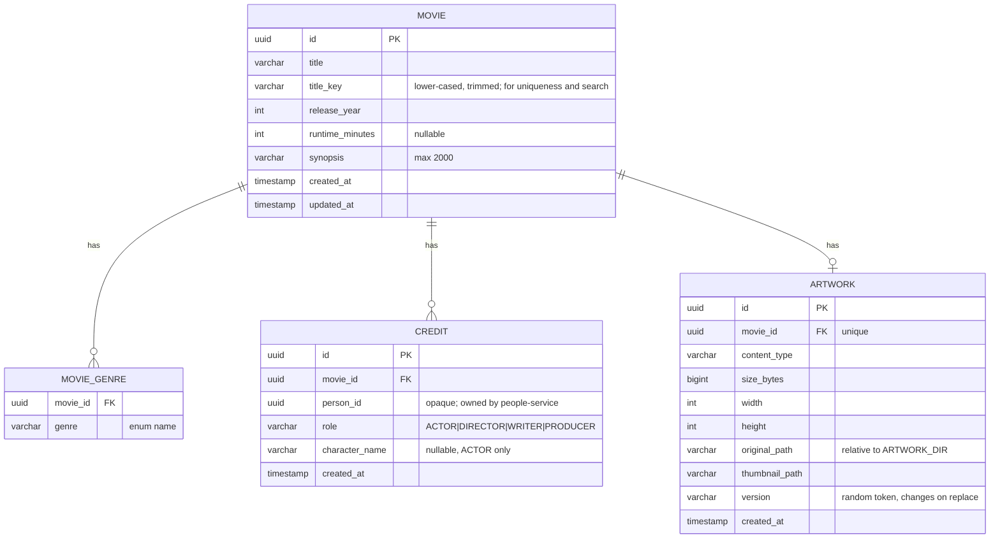
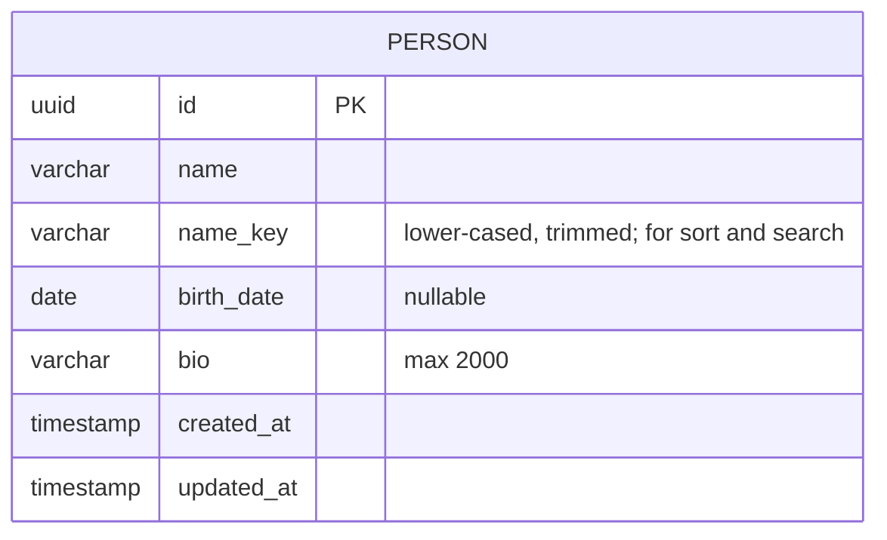

# Data Model

Status: **APPROVED 2026-10-21** (with the architecture) · Version 0.1 · 2026-10-21
Persistence: one H2 file database per service, schema managed by Liquibase (D5, ADR-008). No cross-service foreign keys: `credit.person_id` is an opaque UUID (BR-06).

## movie-service

| Table | Constraints and indexes |
|-------|-------------------------|
| `movie` | PK `id`; **unique** (`title_key`, `release_year`) (BRD movie uniqueness); index on `release_year`; index on `title_key`; check `release_year BETWEEN 1888 AND 3000` as a coarse guard (exact upper bound is enforced in code because it depends on the current year) |
| `movie_genre` | PK (`movie_id`, `genre`); FK `movie_id` → `movie.id` ON DELETE CASCADE; index on `genre` |
| `credit` | PK `id`; FK `movie_id` ON DELETE CASCADE; **unique** (`movie_id`, `person_id`, `role`); index on `person_id` (filmography and credit check); check `character_name IS NULL OR role = 'ACTOR'` |
| `artwork` | PK `id`; FK `movie_id` ON DELETE CASCADE, **unique** `movie_id` (BR-02) |

Artwork files: `{ARTWORK_DIR}/{first two chars of id}/{artwork id}-original.{ext}` and `...-thumb.jpg`. Temporary uploads: `{ARTWORK_DIR}/tmp/{uuid}.part`, deleted on completion, failure or cancel, and swept at startup.

Search (D9): `title_key LIKE :pattern ESCAPE '\'` on the title, `LOWER(synopsis) LIKE :pattern ESCAPE '\'` on the synopsis, and a match on genre display names (for example `Sci-Fi`, not the stored enum `SCI_FI`); the pattern is `%` + escaped lower-cased query + `%`.

## people-service

| Table | Constraints and indexes |
|-------|-------------------------|
| `person` | PK `id`; index on `name_key`. Names are **not** unique (different people share names) |

## Validation placement

| Rule source | Enforced in |
|-------------|-------------|
| BRD section 7 field rules | Domain/service layer of the owning service (authoritative); frontend mirrors; DB constraints as a last line of defence for uniqueness and lengths |
| Uniqueness (movie, credit) | DB unique constraints; service translates the violation to `ALREADY_EXISTS` with the BRD message key (race-safe) |
| Person existence for credits | Gateway pre-check (CR-02); drift tolerated by BR-07 |

## Migrations

Liquibase YAML changelogs per service in `src/main/resources/db/changelog/`, one changeset per table group, never edited after release. Startup on an empty directory must succeed (NFR-REL-04).
