# Dependency Map

```mermaid
flowchart LR
  S001["S-001 Repository and build scaffold"]
  S002["S-002 Quality gates, hooks and CI"]
  S003["S-003 Frontend scaffold, design system and s"]
  S004["S-004 Walking skeleton: frontend to gateway "]
  S101["S-101 Create person"]
  S102["S-102 List people with paging and sorting"]
  S103["S-103 Get and update person"]
  S104["S-104 Delete person (no credits)"]
  S201["S-201 Create movie"]
  S202["S-202 List movies (paging, empty state, plac"]
  S203["S-203 Movie detail page (fields)"]
  S204["S-204 Update movie"]
  S205["S-205 Delete movie with confirmation"]
  S206["S-206 Sort and filter movies"]
  S301["S-301 Artwork validation and storage in movi"]
  S302["S-302 Thumbnails and artwork download in mov"]
  S303["S-303 Gateway multipart upload and artwork G"]
  S304["S-304 Frontend artwork uploader with progres"]
  S305["S-305 Show artwork: thumbnails in lists, ori"]
  S306["S-306 Replace and remove artwork"]
  S401["S-401 Add credit to a movie"]
  S402["S-402 Movie page credits with batched name r"]
  S403["S-403 Update and remove credit"]
  S404["S-404 Person filmography page"]
  S405["S-405 Block deleting a person who has credit"]
  S406["S-406 Movie deletion cleans up credits and a"]
  S501["S-501 Search backend and gateway merge"]
  S502["S-502 Search UI with debounce and full state"]
  S503["S-503 Show more results per group"]
  S601["S-601 Seed data script"]
  S602["S-602 Responsive and accessibility verificat"]
  S603["S-603 End-to-end journeys"]
  S604["S-604 Performance and security verification"]
  S605["S-605 README, AI-usage statement and explana"]
  S606["S-606 Optional Docker Compose setup"]
  S607["S-607 Final audit and clean-setup validation"]
  S701["S-701 Visual refresh: poster grid, cinemati"]
  S702["S-702 Search scope, year picker, multi-gen"]
  S001 --> S002
  S001 --> S004
  S003 --> S004
  S004 --> S101
  S101 --> S102
  S102 --> S103
  S103 --> S104
  S004 --> S201
  S201 --> S202
  S202 --> S203
  S203 --> S204
  S203 --> S205
  S202 --> S206
  S201 --> S301
  S301 --> S302
  S301 --> S303
  S302 --> S303
  S004 --> S303
  S303 --> S304
  S203 --> S304
  S305 --> S304
  S302 --> S305
  S303 --> S305
  S202 --> S305
  S203 --> S305
  S304 --> S306
  S305 --> S306
  S203 --> S401
  S103 --> S401
  S401 --> S402
  S305 --> S402
  S402 --> S403
  S404 --> S403
  S401 --> S404
  S103 --> S404
  S402 --> S404
  S305 --> S404
  S104 --> S405
  S401 --> S405
  S205 --> S406
  S306 --> S406
  S401 --> S406
  S201 --> S501
  S101 --> S501
  S501 --> S502
  S003 --> S502
  S203 --> S502
  S103 --> S502
  S502 --> S503
  S306 --> S601
  S401 --> S601
  S402 --> S602
  S405 --> S602
  S503 --> S602
  S206 --> S602
  S403 --> S602
  S404 --> S602
  S306 --> S603
  S405 --> S603
  S503 --> S603
  S206 --> S603
  S601 --> S603
  S603 --> S604
  S601 --> S604
  S603 --> S605
  S601 --> S605
  S603 --> S606
  S602 --> S607
  S603 --> S607
  S604 --> S607
  S605 --> S607
  S601 --> S607
  S206 --> S701
  S304 --> S701
  S305 --> S701
  S306 --> S701
  S402 --> S701
  S404 --> S701
  S502 --> S701
  S701 --> S702
  S206 --> S702
  S501 --> S702
  S502 --> S702
  S702 --> S602
```

## Waves (stories in a wave can start once the previous waves are done; parallel work still needs agreed interfaces)

| Wave | Stories |
|-----:|---------|
| 1 | S-001, S-003 |
| 2 | S-002, S-004 |
| 3 | S-101, S-201 |
| 4 | S-102, S-202, S-301, S-501 |
| 5 | S-103, S-203, S-302, S-206 |
| 6 | S-104, S-204, S-205, S-303, S-401, S-502 |
| 7 | S-305, S-405, S-503 |
| 8 | S-304, S-402 |
| 9 | S-306, S-404 |
| 10 | S-406, S-403, S-601 |
| 11 | S-701, S-603 |
| 12 | S-702, S-604, S-605, S-606 |
| 13 | S-602 |
| 14 | S-607 |
